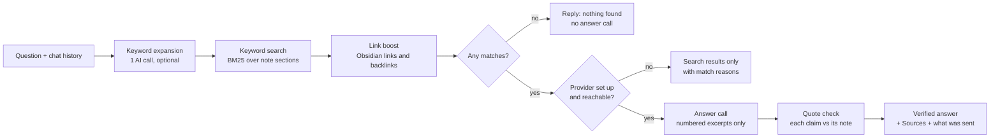

# Spec: Graphite

| Field | Value |
|---|---|
| Version | 0.2 draft (adds verified quotes, search without AI, match explanations, transparency) |
| Author | Charan Sandaka |
| Date | 2 November 2026 |
| Status | Approved 2 November 2026 |

---

## Objective

### What
Graphite is an Obsidian plugin that lets people chat with their vault. You ask a question in plain language. Graphite finds the notes related to it, answers from what is written in them, and links every claim to the note it came from.

### Why
- Obsidian search matches exact words. People remember what a note was about long after they forget how they worded it.
- An AI tool reading a vault can name notes, paths or content that don't exist. Once a user catches one invented note, they stop trusting the tool.
- Smart Connections and Copilot for Obsidian answer with citations. Their public docs describe no check that the cited note says what the answer claims. Claude Vault Citations grounds claims through Anthropic's Citations API, so it works only with Anthropic.
- Several vault AI plugins work with one or two providers only (VaultAI with Gemini, Vault LLM Assistant with OpenAI and Gemini).

### What makes Graphite different
Every claim in an answer carries an exact quote, and Graphite checks that quote against the note text before showing it. This works with any provider, including local models. Search also works with no AI configured.

### Who
People with large personal vaults (students, engineers, researchers, writers) who already have an AI provider account or run a local model.

### Principles
1. Every claim shown carries a quote that Graphite found in the cited note. Claims that fail the check are removed. If nothing relevant is found, Graphite says so.
2. Search runs locally and works before a provider is set up, offline, or when the provider fails.
3. Users can see why each note matched and exactly what was sent to their provider.
4. Users bring their own provider: an OpenAI-compatible API (OpenAI, Groq, OpenRouter, LM Studio), Anthropic, or Ollama. Graphite has no server and needs no account.
5. Graphite never creates, edits or deletes notes.

### User stories and acceptance criteria

| ID | Story | Acceptance criteria |
|---|---|---|
| US-1 | As a user, I ask "where did I write about X?" and get the right notes. | Results show note title, folder path and the matching excerpt. Clicking a result opens the note. Ctrl/Cmd+click opens it in a new tab. |
| US-2 | As a user, I ask "what did I decide about X?" and get an answer I can check. | Every claim has a citation linking to a real note. Its quote opens by click or keyboard (hover may also show it, but never only hover) and is found in that note. Claims whose quote isn't found are removed, and the answer says how many were removed. A Sources list under the answer shows the excerpts used. |
| US-3 | As a user, I'm told plainly when my vault has nothing on the topic. | If search returns no matches, the AI is not called, and Graphite replies that no notes matched, with the search terms it tried. |
| US-4 | As a user, I narrow results with follow-up questions in the same chat. | Follow-ups use the earlier conversation, e.g. "only the ones about Firestore". A "New chat" button clears the history. |
| US-5 | As a user, I use my own provider and key. | Settings cover the three provider types. A "Test connection" button reports success or a plain-language error. Keys are stored in Obsidian's secret storage. |
| US-6 | As a user, I can see what Graphite is doing while I wait. | The panel shows each step: "Searching your notes", "Reading 8 notes", "Writing answer". |
| US-7 | As a user, I understand errors and know how to fix them. | A wrong key, unknown model, Ollama not running or a rate limit each produce a specific message with the fix. No raw stack traces. |
| US-8 | As a user, I can search my vault before setting up any AI provider. | With no provider configured, or when the provider call fails, the panel shows ranked matching notes with excerpts and explains that AI answers need a provider. No error blocks search. |
| US-9 | As a user, I see why each note was found. | Each result lists the matched words as text ("Matched: firestore, rules") and marks them in the excerpt, or says "Linked from <note>" when it was found through a link. The reason never depends on color alone. |
| US-11 | As a user, I keep private folders out of Graphite. | Folders listed in settings are never indexed, never searched and never sent. Changing the list updates the index without a restart. |
| US-10 | As a user, I see what was sent to my provider and roughly what it cost. | Under each AI answer: the number of excerpts and tokens sent (as reported by the provider), and an expandable view of the exact text sent. |

### How it works



1. **Index (local, no AI).** Each note is split into sections at its headings. Each section is indexed with the note title, aliases, tags, heading, folder and body text, and title matches weigh more than body matches. The index updates when notes are created, edited, renamed or deleted.
2. **Keyword expansion.** The AI turns the question into 3 to 8 search terms and synonyms ("auth" becomes "authentication, login, JWT"). This helps when the user doesn't remember their exact words. It can be turned off to save one AI call per question.
3. **Search.** BM25 ranks sections, and the results are grouped by note.
4. **Link boost.** Notes that link to or from strong matches get a small boost from Obsidian's link graph. Graphite records why each note was found (matched words, or the note it was linked from) so the panel can show it.
5. **No provider.** If no provider is configured, or the call fails, Graphite stops here and shows the ranked results with their match reasons.
6. **Answer.** The AI receives only the numbered excerpts. It must answer only from them, and end every claim with a citation carrying an exact quote from that excerpt, like `[2: "we chose Groq for latency"]`.
7. **Quote check.** For each citation, Graphite checks that the number was in the results and that the quote appears in that note's excerpt. Whitespace, letter case and Markdown formatting are normalized first. A claim is shown only if at least one of its citations passes. Failed claims are removed and counted ("1 claim removed: its quote wasn't found in the note"). If no claim passes, the answer is replaced with "I couldn't verify an answer from your notes" plus the matched notes. `[[wikilinks]]` that don't resolve become plain text. The Sources list is always built from the real search results, never from the AI's text.
8. **Transparency.** Graphite records the excerpts sent and the token counts the provider reports, and shows them under the answer.

### Hallucination safeguards

| Risk | Safeguard |
|---|---|
| Cites a note that doesn't exist | Citations are numbers only, and invalid numbers are stripped. |
| Links a missing note with `[[...]]` | Every wikilink is resolved against the vault, and unresolved ones become plain text. |
| Answers when nothing matched | With zero search results, the answer call is skipped. |
| Answers with no grounding | Claims with no citation are removed. If no claim passes, the answer is withheld and the matched notes are shown instead. |
| Misreports what a note says | Each claim must quote the note, and the quote is checked against the note text. Claims whose quote isn't found are removed. |
| A note says "ignore previous instructions" | Note text is fenced off and marked as data, not instructions. |

**Known limit:** Graphite guarantees that every shown claim cites a real, retrieved note and carries a quote that is really in that note. It can't guarantee that the claim reads the quote correctly, for example a quote taken out of context. Showing the quote next to the claim lets the user judge in one glance.

### Panel UI Requirements

**Design direction (approved, Q6).** The panel lives inside Obsidian, next to the user's notes. The proposal is for it to look like part of Obsidian, not a separate product: colors, fonts and spacing come from Obsidian's theme variables, so it follows whatever theme the user runs.
Design Read: an Obsidian sidebar tool for people searching their own notes, in Obsidian's native visual language, dial ENERGY 1 / RHYTHM 1 / MOTION 1. Calm, because the panel sits beside the user's writing and should not compete with it.

Focal point and accent: the answer text is the focal point of the panel. The one accent is the verified quote. Each citation opens its quote in a block set off by Obsidian's blockquote style, so "here is the proof" is the one thing that looks different.

Icons: Obsidian ships the Lucide icon set, and every core panel uses it. Graphite uses Lucide icons from Obsidian's own set so it matches the panels around it. The ribbon icon is an open question (Q7).

States. Each one says what is happening and what to do next:

| State | What the panel shows |
|---|---|
| Index building (first run or rebuild) | "Indexing your vault: `<done>` of `<total>` notes". Questions can be typed while indexing runs, and search uses what is indexed so far. |
| Empty chat | One line saying what Graphite does, plus whether AI answers are on ("AI answers: `<provider>`, `<model>`" or "AI answers off: search only. Set up a provider in Settings"). No made-up example questions about the user's vault. |
| Working | The current step as text (US-6). |
| No matches | US-3. |
| No provider, or provider failed | Search results plus one line explaining why there's no AI answer and how to fix it (US-7, US-8). |
| Claims removed | The answer plus "2 claims removed: their quotes weren't found in the notes". Shown as text, not color alone. |

Keyboard:
- The input is focused when the panel opens. Enter sends, and Shift+Enter adds a new line.
- Tab reaches every control in visual order: input, send, new chat, each citation, each source, the "What was sent" toggle.
- Enter or Space opens a citation's quote and toggles expandable sections. Escape closes an open quote.
- Every focusable element shows a visible focus ring (Obsidian's own, never removed).

Layout: the panel works from 280 px wide (a narrow sidebar) up to a full tab. Long note paths and quotes wrap instead of scrolling sideways, and text stays readable at 200% zoom.

Motion: none beyond Obsidian's own hover and focus states. No spinners that loop without text, since the working state is shown as words.

### Out of scope for v0.1
- Writing to the vault in any form (permanent principle, not only for v0.1)
- Meaning-based (embedding) search (candidate for v0.2)
- Filters by date, folder or tag in natural language (candidate for v0.2)
- Tag-based exclusion (folder exclusion is in v0.1)
- Streaming answers word by word (candidate for v0.3)
- Mobile (candidate for v0.3)

---

## Tech Stack

| Area | Choice | Reason |
|---|---|---|
| Language | TypeScript, strict mode | Required for Obsidian plugins |
| Platform | Obsidian 1.11.4 or later, desktop | 1.11.4 adds `SecretStorage` for API keys |
| Build | esbuild | Obsidian's standard plugin build |
| Search | Own BM25 implementation | Small, fast, offline, no dependency |
| Anthropic | `@anthropic-ai/sdk` | Official SDK with typed errors |
| OpenAI-compatible, Ollama | Obsidian `requestUrl` | Bypasses browser CORS limits, which matters for local servers |
| Tests | Vitest | TypeScript-native and fast |

Exact versions are pinned in `package-lock.json` when dependencies are installed in the Implement phase.

### Settings

| Setting | Default |
|---|---|
| Provider | Groq (an OpenAI-compatible preset), chosen because its free tier lets people try AI answers without paying |
| Provider presets | Groq (`https://api.groq.com/openai/v1`), OpenAI, OpenRouter, LM Studio, Custom OpenAI-compatible, Anthropic, Ollama |
| Groq model | `llama-3.3-70b-versatile`, to be checked against Groq's current model list when the provider task is built |
| Other OpenAI-compatible model | empty (required) |
| Anthropic model | `claude-haiku-5-5` (assumption: cheapest default, to match the cost-first default) |
| Ollama base URL / model | `http://localhost:11434` / empty (required) |
| API keys | Stored in Obsidian SecretStorage |
| Notes per answer | 8 (range 3 to 20) |
| Expand question with AI | On |
| Excluded folders | none |

---

## Commands

```
Install:    npm install
Dev build:  npm run dev          (esbuild watch, writes main.js)
Build:      npm run build        (tsc --noEmit, then production esbuild)
Test:       npm test             (vitest run)
Test watch: npx vitest
```

Manual testing: copy `main.js`, `manifest.json` and `styles.css` to `<test-vault>/.obsidian/plugins/graphite-vault-chat/`, then reload Obsidian.

---

## Project Structure

```
Graphite/
  SPEC.md                  this document
  README.md                user-facing setup and usage
  manifest.json            plugin metadata (id: graphite-vault-chat)
  package.json, tsconfig.json, esbuild.config.mjs, versions.json
  styles.css               panel styles, using Obsidian theme variables
  src/
    main.ts                plugin entry: view, commands, index lifecycle
    settings.ts            settings model and settings tab
    search/                tokenizer, BM25, section splitter, link boost, vault index
    providers/             ChatProvider interface + OpenAI-compatible, Anthropic, Ollama
    chat/                  prompts, pipeline (expand, search, answer, verify), quote check
    ui/                    chat panel view
  tests/                   unit tests, mirroring src/
  test-vault/              small sample vault (about 50 notes) for manual and evaluation runs
  docs/                    architecture notes and decision records
```

Rule: `search/` and `chat/` never import `obsidian`, so they stay testable without the app.

---

## Code Style

```ts
/** A citation passes only if it points at a retrieved note and its quote is really in that note's excerpt. */
export function verifyCitation(citation: Citation, hits: NoteHit[]): boolean {
  const hit = hits[citation.number - 1];
  if (!hit) return false;
  const quote = normalizeForMatch(citation.quote);
  return quote.length > 0 && hit.snippets.some((snippet) => normalizeForMatch(snippet.text).includes(quote));
}
```

- Names say what things are: `verifyCitation`, `NoteHit`, `maxNotes`. No abbreviations beyond common ones (`id`, `url`).
- Small single-purpose functions. Pure logic is kept apart from Obsidian and network code.
- Comments explain why, not what. No commented-out code.
- No `any`. Errors from providers become `ProviderError` with a user-readable message.
- 2-space indent, double quotes, semicolons, trailing commas.

---

## Testing Strategy

| Level | Tool | Covers | Target |
|---|---|---|---|
| Unit | Vitest | tokenizer, BM25, section splitter, link boost, quote check, keyword parsing, pipeline with a fake provider, provider request/response handling with a fake HTTP client | 80% or more line coverage on `search/`, `chat/`, `providers/` |
| Evaluation | Script over `test-vault/` | 30 written questions with expected notes | See Success Criteria |
| Manual | Obsidian with `test-vault/` | Every user story above, on all three providers | All acceptance criteria pass |

Tests live in `tests/`, named after the module (`tests/search/bm25.test.ts`). Each test checks one behavior and says it in its name: `it("drops citation numbers that were not retrieved")`.

---

## Boundaries

**Always**
- Run `npm test` and `npm run build` before every commit.
- Keep `search/` and `chat/` free of Obsidian imports.
- Treat note content as untrusted data in every prompt.
- Credit Charan Sandaka as the author in `package.json`, `manifest.json` and commits. The README carries no author section.
- Write plain Markdown docs with no emojis.

**Ask first**
- Adding any dependency beyond those in Tech Stack.
- Changing the prompt rules or the quote check.
- Changing the plugin ID, minimum Obsidian version or settings format.
- Creating the GitHub repository, or any git push (you run the push yourself).

**Never**
- Write, rename or delete anything in the user's vault.
- Store API keys in `data.json` or source code.
- Send data anywhere except the provider the user configured. No telemetry.
- Delete files or folders without your approval.
- Mention AI tools as authors or contributors in any project file, commit or PR.

---

## Success Criteria

v0.1 is done when all of these are true:

1. Citation validity is 100%. Across the 30 evaluation questions on every provider, every citation shown links to a real note that search returned, and every quote shown is found in that note.
1a. The quote drop rate is measured and reported per provider. Target: no more than 20% of claims removed on the default model of each provider. If a local model exceeds it, the README says so for that model.
2. Retrieval: for at least 25 of the 30 evaluation questions, an expected note appears in the top 8 results.
3. No-match honesty: for 5 questions the test vault can't answer, Graphite says nothing matched in all 5 and names no notes.
4. Speed: search over a 5,000-note vault returns in under 100 ms, excluding AI time. The first full index builds in under 30 seconds.
5. Providers: OpenAI-compatible, Anthropic and Ollama each complete US-1 to US-4 and US-10.
5a. No-provider mode: with no provider configured, US-1, US-3, US-8 and US-9 pass, and Graphite makes no network request.
6. Quality: `npm test` and `npm run build` pass, with 80% or more coverage on `search/`, `chat/` and `providers/`.
7. Install: the release zip installs and works on a clean vault.
8. UI: every item under Panel UI Requirements passes in Obsidian's default light and dark themes, with a recorded click-through of every control.

Targets 2 and 4 are proposed numbers. Adjust them if you want them stricter or looser.

---

## Decisions (2 November 2026)

| # | Question | Decision |
|---|---|---|
| Q1 | Folder exclusion in v0.1? | Yes (US-11). |
| Q2 | Default provider and model | Groq is the default provider, because its free tier lets people use AI answers without paying. Anthropic defaults to `claude-haiku-5-5` (assumption, open to change). |
| Q3 | Keyword expansion on by default? | Yes. |
| Q4 | GitHub repository name and visibility | `whyCharan/Graphite`, public. Decided 2 November 2026, ahead of T18. |
| Q5 | Anthropic's Citations API for the Anthropic provider? | No. One quote check for every provider. |
| Q6 | Panel design direction | Native to Obsidian: theme variables, ENERGY 1 / RHYTHM 1 / MOTION 1, the verified-quote block as the one accent. |

## Open Questions

| # | Question | When it's decided |
|---|---|---|
| Q7 | Ribbon icon: a glyph from Obsidian's built-in Lucide set (for example `quote`), or a custom icon you provide | Release task (T18). Until then, a temporary built-in glyph, marked as temporary. |

---

## Next Steps (gated)

1. Spec approved on 2 November 2026.
2. Plan and task list are tracked outside this repository.
3. Implement task by task, each with tests, after your go-ahead.
